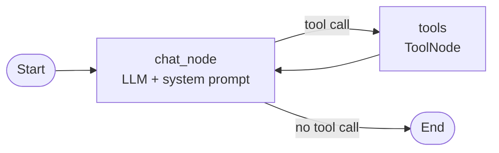

# Agentic-Chatbot-using-LangGraph

# 🤖 Agentic Chatbot using LangGraph

A multi-tool AI agent with a Streamlit chat interface. It can search the web, read your PDFs, do math, check stocks and weather, convert currencies, keep notes, and **pause to ask for your approval** before a stock purchase goes through.


---

## ✨ Features

- **Tool-using agent**: the model decides when to answer directly and when to call a tool.
- **Chat with your PDFs (RAG)**: upload one or more PDFs and ask questions. Each conversation has its own private document store, so a PDF uploaded in one chat is never visible in another.
- **Human-in-the-loop approval**: buying a stock pauses the agent and shows **Approve / Reject** buttons. Nothing happens until you decide.
- **Persistent conversations**: every chat is saved in SQLite. Reopen an old chat from the sidebar and continue where you left off, even after restarting the app.
- **Live streaming**: answers stream token by token, and each tool call shows its status and result in an expandable box.
- **Per-chat notes**: save, list and delete notes that belong only to the current conversation.
- **Safe calculator**: expressions are evaluated with a whitelist, not with raw `eval`.

---

## 🧰 Tools

| Tool | What it does | Needs |
|---|---|---|
| `rag_tool` | Answers questions from the PDFs uploaded in the current chat (FAISS + sentence-transformers) | Uploaded PDF |
| `search_tool` | Searches the web for current information | Tavily API key |
| `calculator` | Maths with `sqrt`, `abs`, `round`, `min`, `max`, `pi`, `e` | None |
| `get_stock_price` | Latest quote for a ticker | Alpha Vantage API key |
| `purchase_stock` | **Simulated** purchase, with human approval and ticker validation | `valid_symbols.csv` |
| `get_weather` | Current weather for a city | Weatherstack API key |
| `exchange_currency` | Live exchange rate between two currencies | ExchangeRate API key |
| `add_notes` / `list_notes` / `delete_note` | Notes stored in SQLite, scoped to the current chat | None |

---

## 🧠 How it works

The agent is a small LangGraph state graph. The model node either answers or asks for a tool; the tool node runs it and hands the result back to the model.



State is checkpointed to `chatbot.db` after every step, and each Streamlit chat is a LangGraph **thread** identified by a UUID.

### Human-in-the-loop, step by step

Example: you type *"buy 10 shares of AAPL"*.

1. The model calls `purchase_stock(symbol="AAPL", quantity=10)`.
2. The tool validates the ticker and quantity, then calls `interrupt("Approve buying 10 shares of AAPL?")`. LangGraph saves a checkpoint and the run stops.
3. The app reads the pending interrupt from the checkpoint and shows a warning with **Approve** and **Reject** buttons. The chat input is disabled until you choose.
4. Your click resumes the graph with `Command(resume="yes")` or `Command(resume="no")`. The tool restarts, `interrupt()` returns your answer, and the order is placed or cancelled.
5. The model writes the final reply, which streams into the chat.

Because the pause lives in the database, the approval buttons survive a page refresh or switching to another chat and back.

### Isolated RAG per conversation

Uploaded PDFs are indexed into `faiss_db/<thread_id>/<file name>/`. The `rag_tool` reads the thread id from the run config and only looks inside that folder, so documents never leak between chats. The model is also given the list of documents available in the current chat.

---

## 📁 Project structure

```
.
├── app.py                # Streamlit frontend: chat UI, sidebar, HITL buttons, PDF upload
├── backend.py            # LangGraph graph, tools, RAG, checkpointer
├── valid_symbols.csv     # Valid stock tickers used by purchase_stock
├── requirements.txt      # Dependencies
├── .env                  # Your API keys (not committed)
├── chatbot.db            # Conversation checkpoints (created at runtime)
├── notes.db              # Notes (created at runtime)
└── faiss_db/             # Per-chat vector stores for RAG (created at runtime)
```

---

## 🚀 Getting started

### 1. Clone and create an environment

```bash
git clone https://github.com/rjragavan007/Agentic-Chatbot-using-LangGraph.git
cd Agentic-Chatbot-using-LangGraph

conda create -n langgraph python=3.11 -y
conda activate langgraph
```

### 2. Install dependencies

```bash
pip install -r requirements.txt
```

### 3. Add your API keys

Create a `.env` file in the project root:

```env
GEMINI_API_KEY=your_key
TAVILY_API_KEY=your_key
ALPHAVANTAGE_API_KEY=your_key
WEATHERSTACK_API=your_key
EXCHANGERATE_API_KEY=your_key

# optional
GROQ_API_KEY=your_key
HF_TOKEN=your_token
```

| Variable | Used for | Where to get it |
|---|---|---|
| `GEMINI_API_KEY` | The language model | Google AI Studio |
| `TAVILY_API_KEY` | Web search | tavily.com |
| `ALPHAVANTAGE_API_KEY` | Stock prices | alphavantage.co |
| `WEATHERSTACK_API` | Weather | weatherstack.com |
| `EXCHANGERATE_API_KEY` | Currency rates | exchangerate-api.com |
| `GROQ_API_KEY` | Optional alternative LLM | console.groq.com |
| `HF_TOKEN` | Optional, removes the Hugging Face rate-limit warning | huggingface.co |

### 4. Add the ticker list

`purchase_stock` checks every symbol against `valid_symbols.csv`. Place the file in the project root with the ticker symbols in the first column. The first two lines are skipped when it is read.

### 5. Run

```bash
streamlit run app.py
```

Run it from the project folder so the relative paths (`valid_symbols.csv`, the databases) resolve correctly. The first start downloads the embedding model, so it takes a little longer.

---

## 💬 Try it

| Say this | What happens |
|---|---|
| `What is sqrt(144) + 2**5?` | Uses the calculator |
| `What's the weather in Chennai?` | Calls the weather tool |
| `How much is 100 USD in INR?` | Fetches the rate, then does the maths |
| `What's the price of AAPL?` | Fetches a live quote |
| `Buy 5 shares of MSFT` | Pauses and asks for your approval |
| `Save a note: submit report on Friday` | Stores a note for this chat only |
| *(attach a PDF)* `Summarise this document` | Indexes the PDF, then answers from it |
| `What happened in tech news today?` | Searches the web |

---

## ⚙️ Configuration notes

- **Switching the model**: change the `llm = ...` line in `backend.py`. A Groq model is included as a commented example. Gemini returns its content as a list of parts, so the app reads `message.text` to get plain text.
- **Starting fresh**: delete `chatbot.db`, `notes.db` and the `faiss_db/` folder.
- **Keep secrets out of Git**: add this to `.gitignore`:

  ```
  .env
  *.db
  faiss_db/
  __pycache__/
  ```

---

## ⚠️ Limitations

- Stock purchases are **simulated**. No real orders are placed.
- Free API plans have request limits, and the free Weatherstack plan only works over HTTP.
- Only PDF uploads are supported.
- There is no user login. Anyone who can open the app can see every chat stored in its database.
- FAISS indexes are loaded with `allow_dangerous_deserialization=True`. This is safe only because the app creates the indexes itself, so never copy in an index from an untrusted source.

---

## 🗺️ Ideas for next steps

- Support DOCX and web pages as RAG sources
- Authentication and per-user chat history
- Real brokerage integration behind the same approval step
- Unit tests for the tools

---

## 🙏 Acknowledgements

Built while following a LangGraph tutorial series from the youtube channel **DSwithBappy**, then extended with SQLite notes, a currency converter, a whitelisted calculator, ticker validation, and per-conversation multi-PDF RAG.

Made with LangGraph, LangChain, Streamlit, FAISS, GROQ and Gemini.
